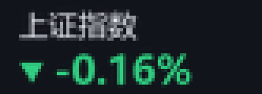

# 任务栏股票小组件（第四版 · 排版收尾）

> 当前版本 **v0.1.0**，发布说明见 [RELEASE_NOTES.md](RELEASE_NOTES.md)。

Windows 任务栏内嵌股票行情组件：贴在系统托盘左侧、与任务栏同高、背景逐像素透明，显示中文名、价格/涨跌幅、分时走势与沪深涨跌家数，3 秒轮询。已打包单文件 exe。

| 走势模式（默认 80%） | 迷你模式（仅名称 + 涨跌幅） |
| --- | --- |
|  |  |

60% 与 140% 的排版对照：[compare_scales.png](compare_scales.png)。

设置窗口（含按名称搜索的结果下拉）：[preview_settings.png](preview_settings.png)。

## 一、第四版结论

| 用户反馈 | 状态 | 说明 |
| --- | --- | --- |
| 迷你模式只显示名称 + 涨跌幅 | ✅ 实机验证 | 迷你卡片不画走势线；涨跌家数卡片只在走势模式参与布局，切迷你时整块移除并释放宽度；右边缘始终贴托盘左侧 6px |
| 可调大小（整体缩放） | ✅ 实机验证 | 60%~140%，步进 10%，默认 80%；设置窗下拉框 + 组件上 `Ctrl+滚轮` / `Shift+滚轮` 实时缩放；写入配置重启保持 |
| 去掉黑色描边 | ✅ 逐像素 alpha | 弃用 Tk color-key，改为 Pillow RGBA + Win32 `UpdateLayeredWindow`；文字 3 倍超采样后缩放；浅底深字、深底白字 |
| 1B0905 添加失败 | ✅ 已修复 | 是同花顺/券商终端的指数内部代码，本地旧的纯数字/纯字母校验把它拒了；现在本地规则 + 东财搜索兜底都能解析成 `sh000905` |
| 按名称搜索添加 | ✅ 实机验证 | 设置窗输入名称/代码/拼音首字母，300ms 防抖 + 后台线程；点击或回车添加，重复标的提示「已在自选中」；接口失败退回本地名称缓存 |
| 打包 exe | ✅ 已重新打包 | `dist/TaskbarStock.exe`（x64、单文件、无控制台）；源码验证通过，本机 SAC 导致 exe 未二次双击验证（详见第六节） |

## 二、迷你模式与缩放

### 迷你模式

- 走势模式：`名称 / 价格 / 涨跌幅 / 走势线`，末尾可挂涨跌家数卡片。
- 迷你模式：只画 `名称 + 涨跌箭头 + 涨跌幅`，**不画走势线、不显示涨跌家数**。
- 切换模式会立即重排：`_replan()` 按新宽度/高度重新计算、`_reposition()` 重新贴靠，右边缘由托盘左侧反推，切换过程不跑位。

实测（本机、浅色任务栏、托盘左侧，右边缘固定 1540 = 托盘左 1546 − 6）：

| 缩放 | 走势模式（卡 + 家数） | 迷你模式 |
| --- | --- | --- |
| 60% | 216 × 24 | 62 × 23 |
| **80%（默认）** | **288 × 32** | **83 × 30** |
| 100% | 360 × 40 | 104 × 38 |
| 140% | 504 × 48（高度被任务栏 48 夹住） | 146 × 48 |

### 字号与间距（100% 基准）

| 元素 | 基准字号 | 说明 |
| --- | --- | --- |
| 现价 | 18 | 走势模式主信息，加粗 |
| 迷你涨跌幅 | 16 | 迷你模式唯一主信息，加粗 |
| 走势涨跌幅 | 12.5 | 次级信息，同色不粗 |
| 名称 | 11.5 | 两种模式共用，仅作标识 |
| 涨跌家数数字 | 11.5 | 与名称同级，加粗 |
| 涨/跌/平 标签 | 10.5 | 单字 CJK，硬下限 7.5px，再小会糊成色块 |

- 内边距：走势 `10`、迷你 `8`（按缩放取整后 6/8/10/14 与 5/6/8/11）。
- 卡宽：走势 `220`（自适应下限 `168`）、迷你 `104`、家数 `132`（下限 `96`／上限 `200`）；80% 下迷你卡 83px，满足「不超过 110px」。
- 卡高：走势 `40`、迷你 `38`，再按任务栏高度夹取。
- 行位置：名称中心在 `0.26 × 卡高`；现价/涨跌幅/家数共用一条基线，基线 = `卡高 − max(3, s(3))`，所以字号不同也齐平，底边固定留 3px 呼吸。

实际像素（`_fs` 按缩放取整到 0.1，且不低于 7px）：

| 元素 | 60% | 80% | 100% | 140% |
| --- | --- | --- | --- | --- |
| 名称 | 7.0 | 9.2 | 11.5 | 16.1 |
| 现价 | 10.8 | 14.4 | 18 | 25.2 |
| 走势涨跌幅 | 7.5 | 10 | 12.5 | 17.5 |
| 迷你涨跌幅 | 9.6 | 12.8 | 16 | 22.4 |
| 家数数字 | 7.0 | 9.2 | 11.5 | 16.1 |
| 涨/跌/平 | 7.5 | 8.4 | 10.5 | 14.7 |

### 整体缩放

- 范围 60%~140%，步进 10%，默认 **80%**（旧配置会自动迁移一次，不会覆盖之后手选的值）。
- 设置窗口右侧“整体缩放”下拉框；组件上 `Ctrl+滚轮` 或 `Shift+滚轮` 直接缩放，弹出当前百分比提示。
- 缩放同步作用于：卡片宽度、字号、走势线粗细、末端圆点、涨跌家数卡片宽度、间距。
- 触顶：到 60% / 140% 时提示「已达下限 60%」/「已达上限 140%」，不会继续变大。
- 高度上限 = 任务栏高度；宽度上限 = 托盘左侧可用空间（放不下时先压卡片宽度，再减同时显示只数，最后才隐藏涨跌卡）。
- 缩放写入 `config.json` 的 `window.scale`，重启保持；拖动偏移仍按“相对托盘默认落点”保存，尺寸变化后自动重算落点。

## 三、文字无描边（逐像素 alpha）

旧方案用 Tk 的 `-transparentcolor`（color-key）做圆角和透明：文字抗锯齿像素会与色键颜色混合，边缘出现 1px 暗边。第四版改为：

1. Pillow 在 `RGBA` 画布上绘制（`app/ui_render.py`）：颜色按色号分组画到 3 倍大小的 L 遮罩，最后 `LANCZOS` 缩放并只给“纯色层”设置 alpha，**RGB 始终是文字本来的颜色**，不会和黑色混合。
2. Win32 `UpdateLayeredWindow` 提交 32 位 BGRA 位图（`app/platform_win.py` 的 `LayeredSurface`），真彩色 + 逐像素透明；窗口不再是色键透明。
3. 透明像素会被系统判定为点击穿透，因此保留一层 `alpha≈0.4%` 的命中窗口接收拖动/点击/右键/滚轮。
4. 文字取色自适应：任务栏亮度 < 0.5 用深色主题（白字），否则用浅色主题（深字）；不靠描边提高对比。

验证方式（本机浅色任务栏）：

- 真实截图 4~6 倍放大：`check_edge_real_light.png`、`check_edge_real_trend.png`；文字周围没有黑色描边/暗色光晕。
- 逐像素检查：单卡片区域最暗像素为 `(64,70,83)`，没有 < 0.06 亮度的像素（有黑描边会接近 `(0,0,0)`）。
- 直接检查 Pillow RGBA 输出：非透明像素的 RGB 只有两种，正是 `#151922`（名称）与 `#d21f3a`（跌幅），无任何混色。
- 深色底模拟：`check_edge_dark.png` 把同一套渲染合成到 `#202020` 上，白字边缘干净、无暗边。

## 四、1B0905 是怎么回事

**结论：`1B0905` 不是错误码，而是同花顺/华泰涨乐等终端使用的“沪市指数内部代码”，对应中证 500（交易所代码 `000905`、腾讯/新浪写法 `sh000905`、东财 secid `1.000905`）。旧版本添加失败，是因为本地校验只接受纯数字或纯字母代码，含字母+数字的 `1B0905` 被直接判为“格式无法识别”。**

证据：

- 旧代码 `_infer_symbol` 只处理 `text.isdigit()` / `text.isalpha()`，`1B0905` 两者都不满足，直接返回空串，界面只给一句笼统提示。
- 东财搜索接口按字面量 `1B0905` 查：`QuotationCodeTable.Data: null, TotalCount: 0`（搜索接口不认这个别名）。
- 同花顺/券商终端页面使用该代码：`q.10jqka.com.cn/zs/detail/code/1B0905/`，页内对应中证 500、`tradingCode=1B0905`。
- 按 `000905` 搜索可解析到东财 `QuoteID = 1.000905`（中证500）；腾讯 `sh000905` 返回中文名「中证500」。

修复（`app/config.py` 的 `normalize_symbol()` + `app/market.py` 的 `resolve_input()`）：

1. 先规范化：去空格/全角/换行、转大写。
2. 本地规则依次识别：`000905.SH` 后缀式 → `1.000905` 东财 secid → **`1B0905` / `0B399905` 终端指数代码** → `sh000905` / `sh.000905` 前缀式 → 纯数字（`000xxx` 命中上证指数表走 `sh`、`6/5` 开头走 `sh`、`3` 走 `sz`、`4/8` 走 `bj`）→ 纯 ASCII 字母走美股。
3. 本地规则失败时，自动调东财搜索接口按代码/名称解析成标准 secid，再回写行情校验。
4. 仍解析不到才报错，且提示改为「未找到「xxx」，试试 000905 / sh000905 / 中证500」，不再笼统失败。
5. 解析结果写入配置目录的 `resolved.json` 缓存，下次同写法直接命中。

现在支持的写法（均已实测添加成功，显示中文名「中证500」、点位与涨跌幅、走势正常）：

```
1B0905      -> sh000905     （终端内部代码）
000905      -> sh000905     （纯数字，自动补 sh）
sh000905    -> sh000905
sh.000905   -> sh000905
000905.SH   -> sh000905
1.000905    -> sh000905     （东财 secid）
中证500      -> sh000905     （走搜索接口）
```

注意：`sz399905` 是深市另一只标的，不会被误认成中证 500；`000001` 仍按平安银行 `sz000001` 处理（上证指数请写 `sh000001` 或 `000001.SH`）。

## 五、配置

配置目录优先级：`TASKBARSTOCK_HOME` → `%APPDATA%\TaskbarStock` → `%LOCALAPPDATA%\TaskbarStock` → 程序/exe 同目录 `data`。

```jsonc
{
  "watchlist": [
    { "symbol": "sh600519", "alias": "贵州茅台" },
    { "symbol": "sz000001", "alias": "平安银行" },
    { "symbol": "sh000001", "alias": "上证指数" }
  ],
  "display": {
    "mode": "trend",          // trend / mini
    "visible_count": 1,       // 1~3
    "show_breadth": true,     // 仅走势模式生效
    "rotate_seconds": 10,
    "color_style": "cn"       // cn=红涨绿跌 / intl=绿涨红跌
  },
  "data": {
    "provider": "auto",       // auto / tencent / sina
    "interval_seconds": 3,
    "timeout_seconds": 6,
    "stale_after_seconds": 30,
    "intraday_refresh_seconds": 60
  },
  "window": {
    "offset_x": 0, "offset_y": 0,
    "max_width": 0,
    "text_theme": "auto",     // auto / dark / light
    "always_on_top": true,
    "scale": 0.8,             // 0.6~1.4
    "scale_version": 2
  }
}
```

## 六、打包与验证

```bat
pip install pillow pyinstaller
python -m PyInstaller --noconfirm --clean TaskbarStock.spec
```

- 产物：`dist/TaskbarStock.exe`（约 35 MB 单文件），PE machine `0x8664`、GUI 子系统（无控制台），Pillow 已打进包内。
- 仓库不提交 `dist/`（35 MB 二进制会拖慢克隆），`.gitignore` 已排除 `build/`、`build_probe/`、`dist/`；需要分发时把 exe 作为 GitHub Release 附件上传。
- 本机源码实跑验证通过：添加 `1B0905`/`000905`/`sh000905` 均成功；迷你模式无走势线/无涨跌家数；Ctrl/Shift+滚轮缩放并落盘；放大到 140% 高度被任务栏夹到 48px 且提示上限；切回 80% 右边缘仍贴托盘；60/80/100/140% 四档两模式逐一截图无出格、无裁切。
- exe 启动验证：命令行启动（等价于双击）后存活 66 秒以上（本次验证时长），`runtime.json` 为 `288×32 @ scale 0.8`、`mode=trend`、`docked=true`，截图确认中文名、现价、涨跌幅、走势线、涨跌家数均正常；窗口 exstyle 含 `WS_EX_LAYERED / TOPMOST / NOACTIVATE / TOOLWINDOW`。本机 Smart App Control 未拦截。未做的是在资源管理器里物理双击这一步。
- 已修复：切换缩放/模式时若窗口新尺寸尚未生效就提交分层位图，会整块变黑；现在统一走 `_apply_geometry()`（geometry → canvas → 命中层 → `update_idletasks()`）后再渲染，并对 `UpdateLayeredWindow` 失败写日志。

## 七、已知限制

- 涨跌家数依赖东财 `push2` 接口；本机今天频繁被风控断开（`RemoteDisconnected`），界面按设计显示 `—` 而不是 0（保留旧值时右上角带琥珀点）。用户 Win10 环境此前正常，已加 15 秒节流 + 一次重试降低触发风控的概率。
- 迷你模式与走势模式切换由右键菜单/设置窗触发，切换瞬间会重新贴靠一次，视觉上有一帧重绘。
- 仅主屏底部/顶部横向任务栏完整适配；竖排、自动隐藏、副屏降级为工作区右下角悬浮。
- 透明空白区域仍会接收鼠标（命中层），不穿透到下方任务栏。
- 港股/美股可配置，但分时接口未逐一验证，失败回退日线。
- 文字在 60%~80% 小尺寸下抗锯齿会显略细，这是正常灰度抗锯齿，不是描边；放大到 100% 以上笔画为实心本色。

## 八、目录结构

```
main.py                 入口（DPI、单实例、console 隐藏兜底、异常钩子）
TaskbarStock.spec       PyInstaller 打包配置（构建产物在 dist/，不入库）
config.json             默认配置模板（scale=0.8、visible_count=1）
preview_trend.png       走势模式预览（80%，4x）
preview_mini.png        迷你模式预览（80%，4x）
compare_scales.png      60% 与 140% 排版对照
check_edge_*.png        字体边缘放大验证图
start.bat / start.ps1   源码启动
app/
  config.py             配置读写/校验/代码规范化（1B0905、指数市场判断）
  market.py             ★行情 + 名称缓存 + 代码搜索解析 + 涨跌家数 + 轮询
  core.py               装配层
  ui_widget.py          ★任务栏组件（贴靠、缩放、模式重排、菜单）
  ui_render.py          ★Pillow 逐像素 alpha 渲染
  ui_settings.py        设置窗口（缩放下拉框、代码添加）
  platform_win.py       Win32（任务栏/托盘矩形、DPI、UpdateLayeredWindow、单实例）
  ui_common.py          配色/字体
  tray.py / icon.py     托盘与图标
  util.py               日志
```
