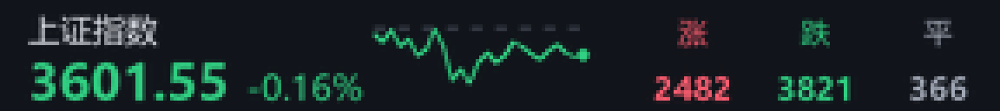
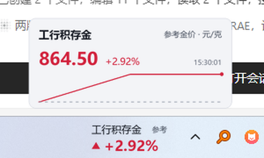

# 任务栏股票小组件（v0.2.1）

> 当前版本 **v0.2.1**，发布说明见 [RELEASE_NOTES.md](RELEASE_NOTES.md)。

Windows 任务栏内嵌行情组件：贴在系统托盘左侧、与任务栏同高、逐像素透明，显示中文名、价格/涨跌幅、分时走势、沪深涨跌家数与交易状态；支持 A 股、指数、ETF、银行积存金/参考金价，可自动隐藏、迷你详情浮层与自适应轮询。已打包单文件 exe。

| 走势模式（积存金 + 指数 + 涨跌家数） | 迷你模式详情浮层 |
| --- | --- |
|  |  |

隐藏模式说明（组件完全不可见，鼠标移入托盘左侧热区才显示）：[preview_hidden.png](preview_hidden.png)。

## 一、版本功能

| 功能 | 状态 | 要点 |
| --- | --- | --- |
| 隐藏模式 | ✅ 实机验证 | 默认不可见；鼠标进入热区显示，**移出立即隐藏**（默认延时 0）；热区跟随窗口真实位置；隐藏时全透明且命中层撤下，可点击穿透 |
| 迷你详情浮层 | ✅ 实机验证 | 迷你模式单击弹出临时浮层（现价/涨跌幅/分时/状态），移开或 4s 收起；双击/右键进设置 |
| 银行积存金 | ✅ 实机验证 | 银行无稳定公开源，接入上金所 Au99.99 参考价并醒目标注；支持手动固定价格；独立类型、不显示涨跌家数 |
| 交易状态与倒计时 | ✅ 模拟时钟 + 实机 | 开盘/午休/收盘/非交易日标签；盘前「距开盘 hh:mm:ss」；跨周末/节假日指向下一交易日 09:30 |
| 自适应轮询 | ✅ 模拟 + 实测 | 盘中按用户间隔；午休/收盘/非交易日**停止定时请求**（状态切换补 1 次）；09:30 / 13:00 秒级恢复 |

> 0.2.1 修复：① 隐藏延时默认改为 0（旧配置的 1.5s 默认值会一次性迁移为 0，手选其它值保留）；② 热区改为每次按窗口真实矩形实时计算，拖动/缩放/换屏后立即生效；③ 收盘后/非交易日不再周期请求接口。

## 二、隐藏模式

- 设置项：`display.hidden_mode`（默认 `false`）、`display.hidden_delay`（默认 `0`，范围 0~5，0=松手即隐藏）、`display.hotspot_width`（默认 `160`，范围 60~600，单位 DIP）。右键菜单也可一键开关。
- 延时迁移：0.2.0 的默认值是 1.5s；升级到 0.2.1 时若配置仍是这个旧默认值，会一次性迁为 0，手选过的其它值（如 2.5）保留。
- 热区：**每次调用都按当前窗口的真实矩形（`_x/_y/_size`）重新计算**，不再使用启动时缓存的任务栏锚点。贴靠任务栏时纵向覆盖整条任务栏，横向宽度 `max(卡片宽, hotspot_width)`；未贴靠（拖动后）以窗口为中心外扩 4px，因此拖动、缩放、换屏、轮播宽度变化后热区立即跟随。
- 显隐检测：优先 `WH_MOUSE_LL` 全局低级鼠标钩子（独立线程 + `GetMessageW` 消息循环）；钩子仅在隐藏模式开启时安装，关闭设置即卸载。显示与隐藏使用同一个热区作为边界，避免 0 延时下光标停在边缘反复显隐。钩子安装失败时退化为每 100ms 读取光标位置（仅隐藏模式期间运行）。
- 立即隐藏：`hidden_delay=0` 时鼠标离开热区即撤下窗口，无淡出、无 1.5s 等待；边界有 4px 余量，避免抖动。
- 隐藏状态：`UpdateLayeredWindow` 提交全透明帧，同时 `withdraw` 命中窗口。实测在隐藏位置调用 `WindowFromPoint` 返回 `Shell_TrayWnd`，不会拦截任务栏/下方窗口点击。
- 全屏与锁屏：前台窗口无句柄视为锁屏；覆盖显示器 ≥98% 且无 `WS_CAPTION` 视为全屏。判定持续 0.8s 才收起，避免最大化窗口/切换窗口瞬间误判。全屏/锁屏期间不因热区触发显示。
- 与其它状态：详情浮层打开期间保持可见，浮层关闭后若鼠标已移出则立即隐藏；拖动、缩放、多屏重排、轮播期间不受影响。

## 三、迷你模式详情浮层

- 迷你模式：**单击**展开详情，**350ms 内双击**打开设置，右键菜单也可进入设置。走势模式单击仍打开设置，行为不变。
- 浮层位置：贴在组件上方（任务栏在顶部时贴下方），水平跟随当前卡片中心，并夹取到显示器工作区，不超出屏幕、不遮住托盘。
- 浮层内容：名称、现价/点位、涨跌幅、交易状态、行情时间、分时/日线走势；积存金额外显示「参考金价 · 元/克」与参考价说明。缩放跟随主组件。
- 自动收起：鼠标移出浮层 0.8s 或打开满 4s 自动关闭；点击其它卡片/菜单也会关闭。轮播开启时展示当前轮播项，翻页后浮层内容随当前项更新。
- 样式：`Toplevel` + `WS_EX_NOACTIVATE / TOOLWINDOW`，不进 Alt+Tab、不抢焦点；复用同一套逐像素透明渲染管线，并绘制实底圆角卡片，避免与桌面内容叠字。

## 四、银行积存金

### 调研结论与数据源

工行「积存金」页面为 SPA/需登录，建行、招行、农行页面也没有稳定的公开 JSON 报价；抓取结果没有可长期依赖的买价/卖价接口。因此**不伪造银行报价**，接入上海黄金交易所 **Au99.99** 作为参考价，并明确标注「参考金价，非该行积存金报价」。

- 主源：新浪 `https://hq.sinajs.cn/list=SGE_AU9999`（GBK 文本，字段：现价、昨收、开、高、低、时间、涨跌幅）。
- 备源：东方财富 `push2`，secid `118.AU9999`。
- 单位：**元/克**；涨跌幅按昨收计算；时间取行情源时间。
- 实测取样（2026-11-04）：`15:21:59 864.80 元/克，+2.95%，昨收 840.01`；`15:30:01 864.50 元/克，+2.92%`，source `sge-sina`。
- 失败策略：保留旧值并标 `stale`（界面琥珀点），`runtime.json` 的 `gold_error` 记录原因；断网不闪、不清空。

### 添加方式

设置窗口「添加积存金」：

- 银行下拉：工行积存金、建行积存金、招行黄金账户、农行存金通 —— 均映射到上金所参考价（因为这些银行暂无可稳定获取的公开报价）。
- 上金所参考价：`gold:AU9999`。
- 手动价格：填写名称、现价、昨收，生成 `gold:manual:<时间戳>`；涨跌幅按手动昨收计算，重启保留。

卡片显示名称（如「工行积存金」）、价格、涨跌幅与「参考金价 / 手动」标记；积存金不显示涨跌家数，不套用 A 股「已收盘」；红涨绿跌与股票一致；可与股票混排、参与轮播、迷你模式和隐藏模式。

## 五、交易状态与倒计时

### 状态机（股票 / 指数 / ETF）

| 本地时间 | phase | 标签 | 倒计时 |
| --- | --- | --- | --- |
| 交易日 09:30–11:30 | `trading` | 无 | 无 |
| 交易日 11:30–13:00 | `lunch` | 午间休市 | 无（固定标注，排版稳定） |
| 交易日 13:00–15:00 | `trading` | 无 | 无 |
| 交易日 15:00 之后 | `closed` | 已收盘 | 无 |
| 交易日 09:30 之前 | `preopen` | 未开盘 | 距开盘 `HH:MM:SS` |
| 周末 / 法定休市日 | `holiday` | 休市 | 距下一交易日 09:30（≥24h 显示 `N天HH:MM:SS`） |

- 走势模式：状态标签紧跟在涨跌幅后（例如 `-0.16% 已收盘`），用次级字色，不与主数据抢视觉；盘前倒计时放在卡片右上。
- 迷你模式：收盘/午休在涨跌幅后追加短标签；盘前直接用「距开盘 hh:mm:ss」替代涨跌幅。
- 涨跌家数卡：非交易时段沿用旧值，右上角标注当前状态（如「已收盘」）。
- 积存金：返回 `phase=gold`、无 A 股标签，卡片标记「参考金价」/「手动」，不会错误显示「已收盘」。
- 标签/倒计时由本地时钟驱动，UI 400ms tick 内按秒刷新，不依赖网络请求。

### 交易日历与缓存

- 来源：`https://timor.tech/api/holiday/year/{year}`（公开节假日接口），一次拉取当年 + 次年，只取法定休市日。
- 缓存：配置目录 `trading_calendar.json`，字段 `source`、`fetched_at`、`updated_at`、`years`（每年休市日列表）。有效期 30 天，过期后台刷新。
- 降级：接口失败或未过期但缺年份时保留旧缓存；无缓存则使用「周末休市 + 内置 KNOWN_HOLIDAYS（2025、2026）」表，**不凭猜测编造假期**。
- 更新方式：等待 TTL 自动刷新；或删除 `trading_calendar.json` 后重启；接口每年发布次年安排，发布后下一次刷新会自动补齐。

## 六、自适应刷新

用户设置的 `data.interval_seconds` 只作为**盘中间隔**（默认 3 秒）；0.2.1 起非交易时段不再周期请求：

| 状态 | 股票/指数/ETF | 涨跌家数 | 积存金参考价 |
| --- | --- | --- | --- |
| 盘中 09:30–11:30 / 13:00–15:00 | 用户设置（默认 3s） | 15s | 上金所日盘/夜盘 30s |
| 盘前 | 开盘前 5 分钟内按用户间隔；其余时间**不请求** | 不请求 | 按自身时段 30s / 5 分钟 |
| 午间休市 11:30–13:00 | **不请求**（11:30 切换时补 1 次） | 同左 | 按自身时段 30s / 5 分钟 |
| 收盘后 15:00 起 | **仅 15:00 补 1 次**，之后停止到下一交易日 09:30 | 同左 | 按自身时段（含夜盘）继续更新 |
| 非交易日（周末/节假日） | **启动或进入状态时最多 1 次**，之后停止 | 同左 | 按自身时段低频续更（非交易日 30 分钟） |

- 调度：每轮唤醒取“仍需更新的标的”里最短的间隔，并截断到「下一次状态切换时刻」：`sleep = min(下次唤醒需求, 距 09:30/11:30/13:00/15:00/下一交易日 09:30 的秒数)`。收盘后没有任何周期需求时直接睡到下一交易日 09:30，因此跨夜/周末没有任何定时请求；09:30、13:00 到点即恢复盘中频率，不依赖粗粒度 tick。
- 状态切换补 1 次：`_phase_prev` 与当前 phase 不同时强制请求一次（例如 15:00 拿到最终收盘价、11:30/13:00 补一次），之后该状态不再周期请求。
- 积存金例外：积存金按上金所自身时段（日盘 09:00–11:30、13:30–15:30，夜盘 20:00–次日 02:30）独立调度。仅有积存金时整夜继续低频更新；与股票混排时，A 股非交易时段股票停止，积存金仍按自身时段更新，避免夜里完全看不到金价。
- 强制刷新：右键「立即刷新」、切换标的/保存设置、打开设置窗口、隐藏模式重新显示组件（10 秒节流）都会强制请求一次。停止轮询期间不请求、不置 stale，界面继续显示「已收盘/休市」与旧值，不会误报「行情异常」。
- 模拟时钟实测（3 秒基准）：15:00–次日 09:30 仅 **1** 次（15:00 收盘补价）；周六全天 **1** 次（启动首轮）；盘前 06:00–09:25 只有启动 1 次，09:25 起恢复 3s；09:29:50–09:30:20 共 11 次（4 次盘前 + 7 次盘中）；午间 11:30–13:00 仅 11:30 切换那次，13:00 立即恢复；盘中 10 分钟 200 次作为对照。
- `runtime.json` 的 `adaptive` 与 `poll_log` 记录当前间隔、下一次唤醒，以及每次请求是否真的发出（`stock/breadth/gold/transition/force`），便于核对。

## 七、配置

配置目录优先级：`TASKBARSTOCK_HOME` → `%APPDATA%\TaskbarStock` → `%LOCALAPPDATA%\TaskbarStock` → 程序/exe 同目录 `data`。

```jsonc
{
  "watchlist": [
    { "symbol": "gold:AU9999", "alias": "工行积存金", "kind": "gold",
      "manual_price": 0, "manual_prev": 0, "manual_updated": 0 },
    { "symbol": "sh600519", "alias": "贵州茅台" },
    { "symbol": "gold:manual:1770000000000", "alias": "自定义金价", "kind": "gold",
      "manual_price": 860.0, "manual_prev": 850.0, "manual_updated": 1770000000 }
  ],
  "display": {
    "mode": "trend",          // trend / mini
    "visible_count": 2,       // 1~3
    "show_breadth": true,
    "rotate_enabled": true,
    "rotate_seconds": 10,
    "color_style": "cn",      // cn 红涨绿跌 / intl 绿涨红跌
    "hidden_mode": false,
    "hidden_delay": 0.0,      // 0=移出立即隐藏，可设 0~5 秒
    "hidden_delay_version": 1,
    "hotspot_width": 160
  },
  "data": {
    "provider": "auto",
    "interval_seconds": 3,    // 仅盘中间隔基准
    "timeout_seconds": 8,
    "stale_after_seconds": 30,
    "intraday_refresh_seconds": 60
  },
  "window": {
    "offset_x": 0, "offset_y": 0, "max_width": 0,
    "text_theme": "auto", "always_on_top": true, "scale": 0.8, "scale_version": 2
  }
}
```

## 八、验证记录

- **模拟时钟**（可注入 `datetime`，固定 2026 年日历）：
  - 09:20 preopen，`未开盘` + `00:10:00`；09:31 trading 无标签；11:35 lunch `午间休市`；
  - 13:05 / 14:58 trading；15:01 closed `已收盘`；周六 `休市` + 倒计时；2026-10-01 国庆 `休市` + 倒计时。
  - 09:30 / 13:00 的切换由边界截断触发，模拟窗口内请求在到点后立即恢复基准间隔。
- **真实运行**（2026-11-04 15:52，上证指数与工行积存金混排）：截图显示 `上证指数 3686.17 +2.16% 已收盘`，积存金 `864.50 +2.92% 参考金价`，积存金未被标「已收盘」；涨跌家数卡显示「已收盘」。
- **隐藏模式**：注入鼠标进入热区后 `hidden=false`；移出后 0.2.1 实测 `hidden=true`（原因 `leave`），不再等待 1.5s；隐藏位置 `WindowFromPoint` 返回 `Shell_TrayWnd`。拖动到非贴靠位置后，runtime 中的 `hotzone` 随窗口矩形变化，旧位置不再触发、新位置正常触发。
- **迷你浮层**：单击后 `popup.open=true`、`hidden=false`；截图确认实底卡片、名称、价格、涨跌幅、时间、走势线；移开 4s 后 `popup=null`，随后自动隐藏。
- **积存金**：真实取到 864.50 元/克、+2.92%、行情时间 15:30:01，source `sge-sina`；断网/接口失败保留旧值并标 stale。
- **自适应刷新实测**：0.2.1 模拟时钟统计 15:00–次日 09:30 仅 1 次请求（15:00 收盘补价），之后到开盘前无周期请求；周六全天 1 次；09:30 到点恢复 3s 间隔；盘中 10 分钟 200 次作为对照。

## 九、打包、发布与已知限制

```bat
pip install pillow pyinstaller
python -m PyInstaller --noconfirm --clean TaskbarStock.spec
```

- 产物 `dist/TaskbarStock.exe`（x64、单文件、GUI 无控制台），仓库不提交 `dist/`，发布时作为 Release 附件上传。
- 已打 annotated tag `v0.2.1` 并推送 `main`（不使用 force push）；GitHub Release 若有网页操作限制，按 Release 说明手动上传 exe。

已知限制：

- 银行积存金**没有**稳定公开的买卖价接口，组件显示的是上金所 Au99.99 参考价，不是任一银行的积存金成交价；需要银行报价时请用手动价格。
- 上金所时段简化为日盘 09:00–11:30、13:30–15:30，夜盘 20:00–次日 02:30，法定休市日关闭；未细分周五夜盘跨零点的交易所细则。
- 交易日历依赖 `timor.tech` 公开接口；接口不可用时退化为「周末 + 内置已知节假日」，新假期需等接口/表更新。
- 全屏判定为启发式（覆盖面积 ≥98% 且无标题栏），个别无边框全屏工具可能误判；判定持续 0.8s 才动作。
- 全局鼠标钩子可能被安全软件拦截；此时隐藏模式退化为 100ms 光标轮询，功能可用但 CPU 略高于钩子。
- 非交易时段股票完全停止请求，期间显示的是最后一次成功数据；若 15:00 那次请求失败，界面会保留旧值并标琥珀点，需手动刷新重试。
- 涨跌家数依赖东财 `push2`，本机偶发代理/风控断开，界面保留旧值并显示琥珀点，不会显示 0。
- 未做代码签名，SmartScreen 可能提示「未知发布者」；数据仅供个人参考，不构成投资建议。

## 十、目录结构

```
main.py                 入口（DPI、单实例、异常钩子）
TaskbarStock.spec       PyInstaller 打包配置（dist/ 不入库）
config.json             默认配置模板
preview_trend.png       走势模式预览
preview_popup.png       迷你详情浮层预览
preview_hidden.png      隐藏模式说明
app/
  config.py             配置读写/校验/积存金条目
  market.py             ★行情、积存金参考价、涨跌家数、自适应轮询
  trading.py            ★交易状态机、交易日历缓存、轮询间隔
  core.py               装配层
  ui_widget.py          ★任务栏组件（隐藏模式、浮层、状态标签、菜单）
  ui_render.py          ★Pillow 逐像素 alpha 渲染
  ui_settings.py        设置窗口（隐藏模式、添加积存金）
  platform_win.py       Win32（任务栏、DPI、分层窗口、鼠标钩子、全屏判定）
  ui_common.py          配色/字体
  tray.py / icon.py     托盘与图标
  util.py               日志
```
